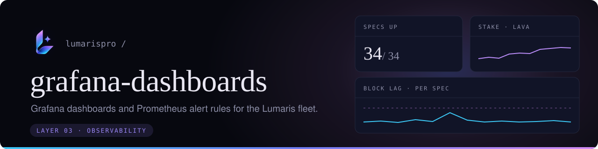

<p align="center">
  
</p>

The Grafana dashboards and Prometheus alert rules we use for the Lumaris fleet: one view for hosts, one for our Lava provider. They expect the metrics from [server-bootstrap](https://github.com/lumarispro/server-bootstrap) (node_exporter) and [lava-provider-exporter](https://github.com/lumarispro/lava-provider-exporter).

## What's here

```
dashboards/
  hosts.json            fleet overview: up/down, CPU, memory, disk, NVMe I/O, network, clock offset
  lava-provider.json    stake, delegations, jails and reported blocks, per spec
rules/
  hosts.yml             host down, disk filling, memory pressure, clock skew, failed units
  lava-provider.yml     exporter down, jailed spec, dropped spec, stale block reports
provisioning/           file-based provisioning for Grafana
prometheus.example.yml  scrape config that feeds both dashboards and loads the rules
```

## Dashboards

**Lava provider** (`lumaris-lava-provider`)
- Headline stats: exporter up, specs staked, specs jailed, total stake, delegations, self delegation
- A table with one row per spec: stake, delegated, jailed, jail count, latest reported block, endpoints
- History: stake and delegations per spec, block report rate, jailed specs over time

**Hosts** (`lumaris-hosts`)
- Fleet stats: hosts up/down, the busiest CPU, fullest memory and disk, shortest uptime
- Per host: CPU, memory, load per core, disk usage, NVMe I/O time, network in/out, TCP connections, clock offset

Both use a `datasource` variable, so they import cleanly into any Grafana 10+ with a Prometheus source.

## Alerts

| Rule | Severity | Fires when |
|---|---|---|
| `LavaProviderJailed` | critical | Provider is jailed on any spec |
| `LavaProviderSpecDropped` | critical | Number of staked specs went down in 30 min |
| `LavaProviderBlockReportStale` | warning | No new block reported for a spec in 2 h |
| `LavaProviderExporterDown` | warning | Exporter can't read the Lava API for 10 min |
| `LavaProviderDelegationDrop` | info | Delegations on a spec fell by more than 20% in 6 h |
| `HostDown` | critical | node_exporter not answering for 3 min |
| `HostDiskAlmostFull` | critical | Less than 5% free on a filesystem |
| `HostDiskFillingUp` | warning | Under 15% free and predicted full within 24 h |
| `HostMemoryPressure` | warning | Less than 8% memory available for 10 min |
| `HostCpuSaturated` | warning | CPU above 90% for 30 min |
| `HostClockSkew` | warning | Clock off by more than 50 ms |
| `HostSystemdUnitFailed` | warning | Any systemd unit in `failed` state |
| `HostRebooted` | info | Host booted less than 10 min ago |

`HostSystemdUnitFailed` needs node_exporter started with `--collector.systemd`, which is off by default.

## Install

Import by hand: **Dashboards → New → Import** and upload a JSON file.

Or provision from disk:

```bash
sudo mkdir -p /var/lib/grafana/dashboards/lumaris
sudo cp dashboards/*.json /var/lib/grafana/dashboards/lumaris/
sudo cp provisioning/dashboards/lumaris.yml /etc/grafana/provisioning/dashboards/
sudo systemctl restart grafana-server
```

Alert rules go next to your Prometheus config:

```bash
sudo cp rules/*.yml /etc/prometheus/rules/
promtool check rules /etc/prometheus/rules/*.yml
sudo systemctl reload prometheus
```

---

<sub>MIT · [lumaris.space](https://lumaris.space)</sub>
